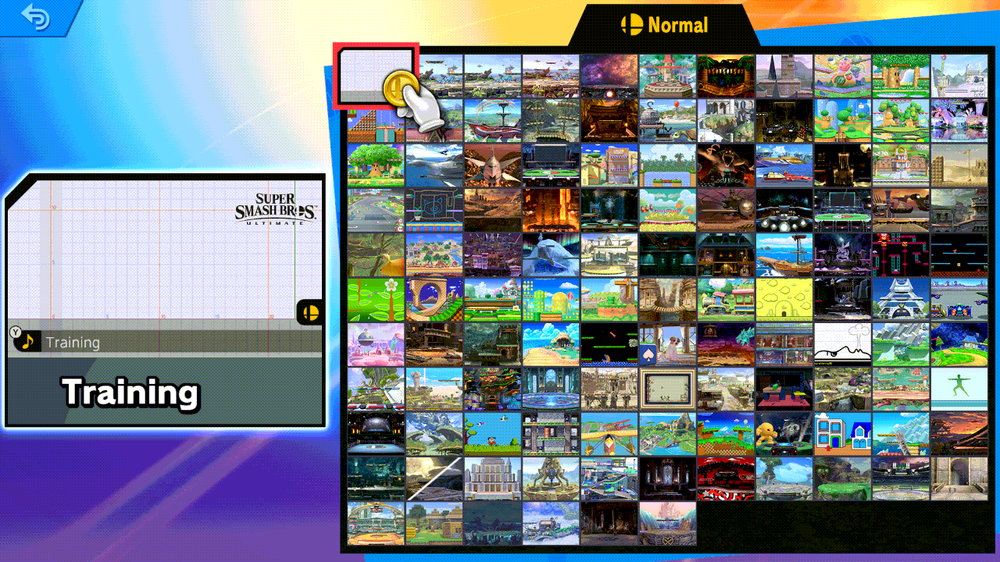
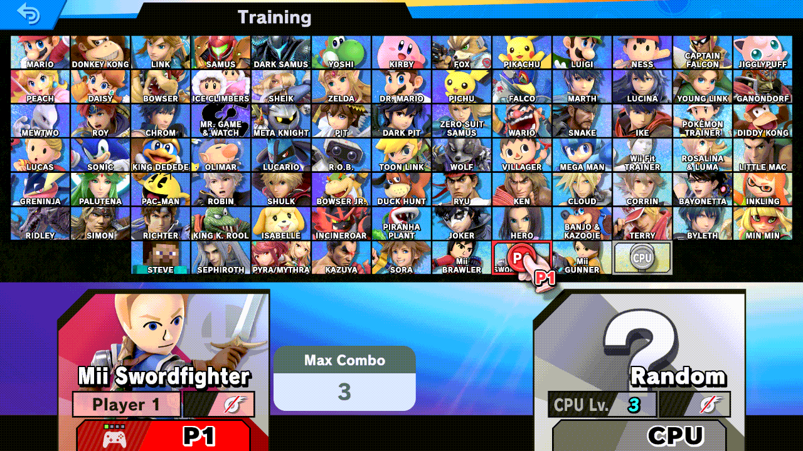
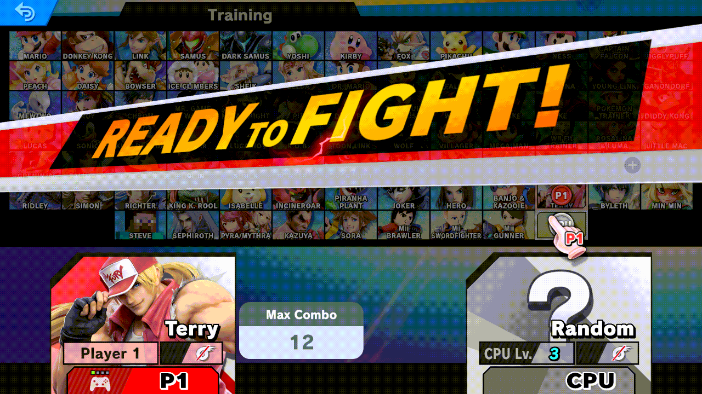

# ssbu-tile-cursor

> **Disclaimer:** this project was developed with the assistance of AI
> (Claude, Codex and other coding agents) under the operator's direction and
> review. Nothing is claimed beyond the dated tests cited below.

Skyline plugin for Super Smash Bros. Ultimate 13.0.5: on the character and
stage select screens, **L3 + D-pad** moves P1's hand exactly one tile. Built
for automation, where stick input overshoots.



*Training's stage select: four L3 + Right steps from the Training tile land on
Final Destination; L3 + Down then moves one row, to Jungle Japes.*



*P1 carries its token from Mii Swordfighter: L3 + Up to Hero, L3 + Right twice
to Terry, then A places it.*



*With P1's token placed, its empty hand picks up the CPU's coin on Random (A),
carries it to Joker (L3 + Left three times, L3 + Up) and drops it (A).*

All three clips: Eden, 2026-11-13, the v0.1.0 release NRO (`b8313ca2…`, build
`15d3f31`). The game shows no input on these screens, so the input labels are
drawn on the clips from the run's own input log.

## Behaviour

- One step per press; held, it repeats every 250 ms. No wrapping at edges.
- Character select: steps only while the hand carries a token (P1's or a
  CPU's). With an empty hand nothing happens; press B to take the token back.
- Without L3 the D-pad and stick behave as in the unmodified game. Nothing
  happens outside these two screens.

## Install

Tested on: Super Smash Bros. Ultimate 13.0.5 · Switch firmware 23.5.0 · Atmosphère 1.12.2

Copy `libssbu_tile_cursor.nro` from the
[v0.1.0 release](https://git.syntaxbyexample.com/intpa/ssbu-tile-cursor/releases/tag/v0.1.0)
(the build tested in Eden) to
`sd:/atmosphere/contents/01006A800016E000/romfs/skyline/plugins/`. It checks
the game version and every hook site at boot and installs nothing if either
differs. Each step is logged to `sd:/ultimate/ssbu-tile-cursor/events.log`,
after the tick:

```text
<tick> step screen=css dir=left from=85 to=84 token=p2 x=288.0 y=-77.0
<tick> settled screen=css at=84 hovered=84 x=288.0 y=-77.0
```

It is a tool for testing in Eden. It has not been tested on a Switch, and
the Switch card's install records from 2026-10-30 to 2026-11-12 do not list
it.

## Build

```text
cargo test
cargo skyline build --release
```

Since `a052fd5` (2026-10-30) `main` builds as a cdylib only, so the release
profile's LTO applies. That NRO differs from the release one and has not been
run in Eden.

Hook sites: [docs/HOOKS.md](docs/HOOKS.md). Eden test procedure and results:
[docs/EDEN-TEST.md](docs/EDEN-TEST.md), [docs/EDEN-RESULTS.md](docs/EDEN-RESULTS.md).

## License

MIT
