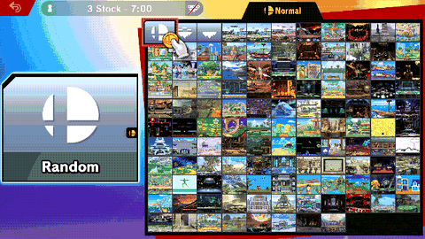
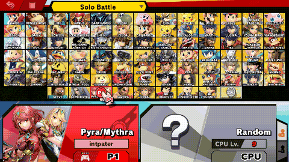

# ssbu-tile-cursor

> **Disclaimer:** this project was developed with the assistance of AI
> (Claude, Codex and other coding agents) under the operator's direction and
> review. Nothing is claimed beyond the dated tests cited below.

Skyline plugin for Super Smash Bros. Ultimate 13.0.5: on the character and
stage select screens, **L3 + D-pad** moves P1's hand exactly one tile. Built
for automation, where stick input overshoots.



*Six L3 + Right steps from Random land on Final Destination; Down and Up move one row.*



*P1 steps to its fighter and places its token, picks up the CPU's coin, and
steps it to Joker.*

Both clips: Eden, 2026-10-29, build `15d3f31`.

## Behaviour

- One step per press; held, it repeats every 250 ms. No wrapping at edges.
- Character select: steps only while the hand carries a token (P1's or a
  CPU's). With an empty hand nothing happens; press B to take the token back.
- Without L3 the D-pad and stick behave as in the unmodified game. Nothing
  happens outside these two screens.

## Install

Copy `libssbu_tile_cursor.nro` to
`sd:/atmosphere/contents/01006A800016E000/romfs/skyline/plugins/`. It checks
the game version and every hook site at boot and installs nothing if either
differs. Each step is logged to `sd:/ultimate/ssbu-tile-cursor/events.log`:

```text
step screen=css dir=left from=85 to=84 token=p2 x=288.0 y=-77.0
settled screen=css at=84 hovered=84 x=288.0 y=-77.0
```

## Build

```text
cargo test
cargo skyline build --release
```

Hook sites: [docs/HOOKS.md](docs/HOOKS.md). Eden test procedure and results:
[docs/EDEN-TEST.md](docs/EDEN-TEST.md), [docs/EDEN-RESULTS.md](docs/EDEN-RESULTS.md).

## License

MIT
